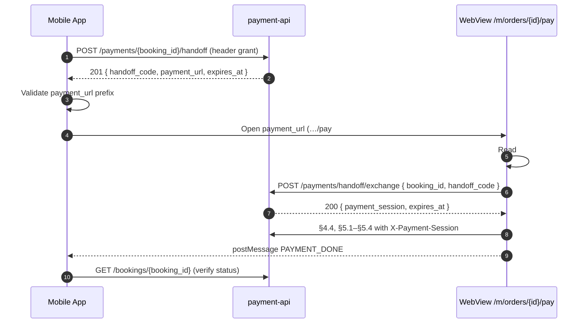

# Design — GH-14 Payment WebView Real Backend

## Overview

GH-14 implements the real payment adapter using WebView handoff as specified in ADR-007. The design follows the authorization-code pattern: the mobile app requests a one-time handoff code, opens a WebView to the payment web app, and the web app exchanges the code for a payment session.

**Key Insight:** The mobile app never touches payment credentials or session tokens directly. It only:

1. Requests a handoff code (using its existing grant)
2. Opens a URL containing the code in a fragment
3. Listens for postMessage events
4. Verifies final status with the backend

---

## Architecture

### Sequence Diagram (from ADR-007)



### Component Architecture

```
┌─────────────────────────────────────────────────────────────────────────┐
│                    src/features/payment/                                │
│                                                                         │
│  ┌─────────────────────────────────────────────────────────────────┐   │
│  │                     domain/ (from GH-13)                        │   │
│  │  PaymentPort interface, types, rules — UNCHANGED                │   │
│  └─────────────────────────────────────────────────────────────────┘   │
│                                │                                        │
│                                │ implements                             │
│                                ▼                                        │
│  ┌─────────────────────────────────────────────────────────────────┐   │
│  │                     data/                                       │   │
│  │                                                                 │   │
│  │  ┌─────────────────────┐   ┌─────────────────────────────────┐  │   │
│  │  │ FakePaymentAdapter  │   │ RealPaymentAdapter (NEW)        │  │   │
│  │  │ (GH-13)            │   │                                 │  │   │
│  │  │                    │   │ - requestHandoff()              │  │   │
│  │  │ For tests/dev      │   │ - validatePaymentUrl()          │  │   │
│  │  └─────────────────────┘   │ - verifyStatus()               │  │   │
│  │                            └─────────────────────────────────┘  │   │
│  └─────────────────────────────────────────────────────────────────┘   │
│                                                                         │
│  ┌─────────────────────────────────────────────────────────────────┐   │
│  │                     presentation/ (NEW)                         │   │
│  │                                                                 │   │
│  │  ┌─────────────────────────────────────────────────────────┐   │   │
│  │  │              PaymentWebView                              │   │   │
│  │  │                                                          │   │   │
│  │  │  - originWhitelist: ['https://rush-my-ticket.my.id']    │   │   │
│  │  │  - onShouldStartLoadWithRequest: filter navigation      │   │   │
│  │  │  - onMessage: handle postMessage events                  │   │   │
│  │  │  - onLoadEnd: detect page ready                         │   │   │
│  │  │  - onError: handle load failures                        │   │   │
│  │  └─────────────────────────────────────────────────────────┘   │   │
│  │                                                                 │   │
│  │  ┌─────────────────────────────────────────────────────────┐   │   │
│  │  │              usePaymentWebView (hook)                    │   │   │
│  │  │                                                          │   │   │
│  │  │  - webViewRef: RefObject<WebView>                       │   │   │
│  │  │  - paymentUrl: string | null                            │   │   │
│  │  │  - isLoading: boolean                                   │   │   │
│  │  │  - error: PaymentError | null                           │   │   │
│  │  │  - requestHandoff(bookingId): Promise<void>             │   │   │
│  │  │  - handleMessage(event): void                           │   │   │
│  │  │  - handleNavigation(request): boolean                   │   │   │
│  │  │  - reload(): void                                       │   │   │
│  │  └─────────────────────────────────────────────────────────┘   │   │
│  └─────────────────────────────────────────────────────────────────┘   │
└─────────────────────────────────────────────────────────────────────────┘
```

---

## Data Flow

### 1. Payment Initiation (Happy Path)

```
User taps "Pay" button
    │
    ▼
usePaymentWebView.requestHandoff(bookingId)
    │
    ├─► POST /payments/{booking_id}/handoff
    │   Headers: X-Grant-Token + X-Device-Id (or Authorization: Bearer)
    │
    ◄── 201 { handoff_code: "hc_...", payment_url: "https://...", expires_at: "..." }
    │
    ▼
validatePaymentUrl(payment_url)
    │
    ├─► URL starts with "https://rush-my-ticket.my.id/m/orders/"? ✓
    │
    ▼
setPaymentUrl(payment_url)  → triggers WebView render
    │
    ▼
<PaymentWebView source={{ uri: paymentUrl }} ... />
    │
    ▼
WebView loads /m/orders/{booking_id}/pay#code=hc_...
    │
    ▼
Web app reads #code, exchanges for payment_session, renders payment UI
```

### 2. postMessage Event Handling

```
WebView calls: window.ReactNativeWebView.postMessage(JSON.stringify({
    type: "PAYMENT_DONE",
    booking_id: "booking_123"
}))
    │
    ▼
onMessage callback fires
    │
    ├─► Validate nativeEvent.url starts with "https://rush-my-ticket.my.id"
    │   (if not, ignore silently)
    │
    ▼
Parse JSON payload: { type, booking_id }
    │
    ▼
Switch on type:
    │
    ├─► PAYMENT_DONE
    │   └─► Close WebView, GET /bookings/{id}, navigate to e-ticket if PAID
    │
    ├─► PAYMENT_EXPIRED
    │   └─► Close WebView, GET /bookings/{id}, show expiry screen
    │
    ├─► HANDOFF_EXPIRED
    │   └─► Request new handoff code, reload WebView
    │
    └─► CLOSE
        └─► Close WebView, GET /bookings/{id}, show appropriate screen
```

### 3. GoPay External Link Flow

```
User taps GoPay payment option in WebView
    │
    ▼
WebView navigates to "gojek.link/..." or "gopay://..."
    │
    ▼
onShouldStartLoadWithRequest fires
    │
    ├─► URL matches "gojek.link/*" or "gopay://*"? ✓
    │
    ▼
Linking.openURL(url)  → Opens GoPay app
return false  → Prevent WebView navigation
    │
    ▼
User completes payment in GoPay app
    │
    ▼
User manually returns to Rusuh app (via app switcher)
    │
    ▼
AppState listener detects "active" state
    │
    ▼
GET /bookings/{booking_id} → Check status
    │
    ├─► status: PAID
    │   └─► Close WebView, navigate to e-ticket
    │
    └─► status: HELD (payment_status: PENDING)
        └─► Keep WebView open, payment still in progress
```

---

## Components and Interfaces

### Components

| Component            | Responsibility                                                                               | Layer        |
| -------------------- | -------------------------------------------------------------------------------------------- | ------------ |
| `RealPaymentAdapter` | Implements PaymentPort via WebView handoff, handles handoff requests and status verification | Data         |
| `PaymentWebView`     | Security-hardened WebView component with origin whitelist and message handling               | Presentation |
| `usePaymentWebView`  | React hook managing WebView state, handoff lifecycle, and event handling                     | Presentation |
| `useGopayHandler`    | Hook for GoPay external link handling and AppState foreground detection                      | Presentation |
| `validatePaymentUrl` | URL validation utility ensuring payment URL matches expected origin                          | Data         |
| `statusMapper`       | Maps booking status to PaymentStatusResult                                                   | Data         |

### Interfaces

```typescript
// === Handoff Types ===

interface HandoffResponse {
  handoffCode: string; // hc_... (256-bit, 60s TTL)
  paymentUrl: string; // https://rush-my-ticket.my.id/m/orders/{id}/pay#code=hc_...
  expiresAt: string; // ISO 8601 timestamp
}

// === WebView Message Types ===

type WebViewMessageType =
  | "PAYMENT_DONE" // /status = PAID
  | "PAYMENT_EXPIRED" // /status = EXPIRED, PAYMENT_WINDOW_CLOSED, or 401 GRANT_TOKEN_INVALID
  | "HANDOFF_EXPIRED" // 401 HANDOFF_CODE_INVALID, page reload, or 401 PAYMENT_SESSION_INVALID
  | "CLOSE"; // User pressed back/close, result button, or MAX_ATTEMPTS_EXCEEDED

interface WebViewMessage {
  type: WebViewMessageType;
  booking_id: string;
}

// === Payment Error Types ===

type PaymentErrorCode =
  | "GRANT_EXPIRED" // 401 GRANT_TOKEN_INVALID
  | "BOOKING_NOT_PAYABLE" // 409 BOOKING_STATUS_INVALID
  | "INVALID_PAYMENT_URL" // URL validation failed
  | "WEBVIEW_LOAD_ERROR" // WebView failed to load
  | "NETWORK_ERROR" // HTTP request failed
  | "MAX_HANDOFF_RETRIES" // Exceeded 3 handoff attempts
  | "TIMEOUT"; // Request or load timeout

interface PaymentError {
  code: PaymentErrorCode;
  message: string;
  details?: unknown;
}

// === Component Props ===

interface PaymentWebViewProps {
  url: string;
  onPaymentComplete: (bookingId: string) => void;
  onPaymentExpired: (bookingId: string) => void;
  onHandoffExpired: (bookingId: string) => void;
  onClose: (bookingId: string) => void;
  onError: (error: PaymentError) => void;
}

// === Hook Return Types ===

interface UsePaymentWebViewResult {
  paymentUrl: string | null;
  isLoading: boolean;
  error: PaymentError | null;
  requestHandoff: (bookingId: string) => Promise<void>;
  handlePaymentComplete: (bookingId: string) => Promise<void>;
  handlePaymentExpired: (bookingId: string) => Promise<void>;
  handleHandoffExpired: (bookingId: string) => Promise<void>;
  handleClose: (bookingId: string) => Promise<void>;
  reload: () => void;
}
```

---

### RealPaymentAdapter

```typescript
/**
 * Real payment adapter implementing PaymentPort via WebView handoff.
 *
 * Unlike FakePaymentAdapter, this delegates most operations to the WebView.
 * The adapter handles handoff code acquisition and status verification.
 */
export class RealPaymentAdapter implements PaymentPort {
  constructor(
    private httpClient: HttpClient,
    private baseUrl: string = "https://api.rush-my-ticket.my.id"
  ) {}

  /**
   * Request handoff code from backend.
   * @throws PaymentError.GRANT_EXPIRED if grant is invalid
   * @throws PaymentError.BOOKING_NOT_PAYABLE if booking status invalid
   */
  async requestHandoff(bookingId: string): Promise<HandoffResponse> {
    const response = await this.httpClient.post(
      `${this.baseUrl}/payments/${bookingId}/handoff`,
      {}, // empty body
      { headers: await this.getGrantHeaders() }
    );
    return {
      handoffCode: response.data.handoff_code,
      paymentUrl: response.data.payment_url,
      expiresAt: response.data.expires_at,
    };
  }

  /**
   * Validate payment URL before opening WebView.
   * @throws PaymentError.INVALID_PAYMENT_URL if URL is malicious
   */
  validatePaymentUrl(url: string): boolean {
    const ALLOWED_PREFIX = "https://rush-my-ticket.my.id/m/orders/";
    if (!url.startsWith(ALLOWED_PREFIX)) {
      throw new PaymentError(
        "INVALID_PAYMENT_URL",
        "Payment URL does not match expected origin"
      );
    }
    return true;
  }

  /**
   * Verify booking status after WebView closes.
   * This is the authoritative check — postMessage is just a signal.
   */
  async verifyStatus(bookingId: string): Promise<BookingStatus> {
    const response = await this.httpClient.get(
      `${this.baseUrl}/bookings/${bookingId}`,
      { headers: await this.getGrantHeaders() }
    );
    return response.data.status;
  }

  // PaymentPort interface methods (delegate to WebView flow)

  async getAvailableMethods(): Promise<AvailableMethod[]> {
    // POC: return hardcoded methods
    // Production: GET /payments/methods
    return [
      { method: "bank_transfer", banks: ["bca", "bni", "bri", "cimb"] },
      { method: "gopay" },
    ];
  }

  async initiatePayment(
    bookingId: string,
    method: PaymentMethod,
    bankCode?: BankCode
  ): Promise<PaymentInitiation> {
    // This adapter uses WebView — actual initiation happens in web
    // Return handoff-based initiation
    const handoff = await this.requestHandoff(bookingId);
    return {
      paymentId: `webview_${bookingId}`,
      method,
      status: "PENDING",
      webViewUrl: handoff.paymentUrl,
      expiresAt: handoff.expiresAt,
    };
  }

  async getPaymentStatus(bookingId: string): Promise<PaymentStatusResult> {
    const status = await this.verifyStatus(bookingId);
    // Map booking status to PaymentStatusResult
    return this.mapBookingToPaymentStatus(status);
  }

  async retryPayment(
    bookingId: string,
    method: PaymentMethod,
    bankCode?: BankCode
  ): Promise<PaymentInitiation> {
    // Request new handoff code
    return this.initiatePayment(bookingId, method, bankCode);
  }
}
```

### PaymentWebView Component

```typescript
interface PaymentWebViewProps {
  url: string;
  onPaymentComplete: (bookingId: string) => void;
  onPaymentExpired: (bookingId: string) => void;
  onHandoffExpired: (bookingId: string) => void;
  onClose: (bookingId: string) => void;
  onError: (error: PaymentError) => void;
}

const ALLOWED_ORIGIN = 'https://rush-my-ticket.my.id';
const GOPAY_PATTERNS = ['gojek.link', 'gopay://'];

export function PaymentWebView({
  url,
  onPaymentComplete,
  onPaymentExpired,
  onHandoffExpired,
  onClose,
  onError,
}: PaymentWebViewProps) {
  const webViewRef = useRef<WebView>(null);

  const handleShouldStartLoad = useCallback((request: ShouldStartLoadRequest) => {
    const { url: requestUrl } = request;

    // Allow payment origin
    if (requestUrl.startsWith(ALLOWED_ORIGIN)) {
      return true;
    }

    // Handle GoPay links externally
    if (GOPAY_PATTERNS.some(pattern => requestUrl.includes(pattern))) {
      Linking.openURL(requestUrl);
      return false;
    }

    // Block all other navigations
    console.warn('[PaymentWebView] Blocked navigation to:', requestUrl);
    return false;
  }, []);

  const handleMessage = useCallback((event: WebViewMessageEvent) => {
    // Validate origin
    if (!event.nativeEvent.url.startsWith(ALLOWED_ORIGIN)) {
      return; // Silently ignore messages from unknown origins
    }

    try {
      const data = JSON.parse(event.nativeEvent.data);
      const { type, booking_id } = data;

      switch (type) {
        case 'PAYMENT_DONE':
          onPaymentComplete(booking_id);
          break;
        case 'PAYMENT_EXPIRED':
          onPaymentExpired(booking_id);
          break;
        case 'HANDOFF_EXPIRED':
          onHandoffExpired(booking_id);
          break;
        case 'CLOSE':
          onClose(booking_id);
          break;
        default:
          console.warn('[PaymentWebView] Unknown message type:', type);
      }
    } catch (e) {
      console.warn('[PaymentWebView] Invalid message format:', e);
    }
  }, [onPaymentComplete, onPaymentExpired, onHandoffExpired, onClose]);

  return (
    <WebView
      ref={webViewRef}
      source={{ uri: url }}
      originWhitelist={[ALLOWED_ORIGIN]}
      onShouldStartLoadWithRequest={handleShouldStartLoad}
      onMessage={handleMessage}
      onError={(syntheticEvent) => {
        const { nativeEvent } = syntheticEvent;
        onError(new PaymentError('WEBVIEW_LOAD_ERROR', nativeEvent.description));
      }}
      javaScriptEnabled={true}
      setSupportMultipleWindows={false}
      allowFileAccess={false}
      sharedCookiesEnabled={false}
      testID="payment-webview"
    />
  );
}
```

### usePaymentWebView Hook

```typescript
interface UsePaymentWebViewResult {
  paymentUrl: string | null;
  isLoading: boolean;
  error: PaymentError | null;
  requestHandoff: (bookingId: string) => Promise<void>;
  handlePaymentComplete: (bookingId: string) => Promise<void>;
  handlePaymentExpired: (bookingId: string) => Promise<void>;
  handleHandoffExpired: (bookingId: string) => Promise<void>;
  handleClose: (bookingId: string) => Promise<void>;
  reload: () => void;
}

export function usePaymentWebView(
  adapter: RealPaymentAdapter,
  onSuccess: (bookingId: string) => void,
  onExpired: (bookingId: string) => void
): UsePaymentWebViewResult {
  const [paymentUrl, setPaymentUrl] = useState<string | null>(null);
  const [isLoading, setIsLoading] = useState(false);
  const [error, setError] = useState<PaymentError | null>(null);
  const [bookingId, setBookingId] = useState<string | null>(null);
  const handoffRetryCount = useRef(0);

  const requestHandoff = useCallback(
    async (bid: string) => {
      setIsLoading(true);
      setError(null);
      setBookingId(bid);

      try {
        const handoff = await adapter.requestHandoff(bid);
        adapter.validatePaymentUrl(handoff.paymentUrl);
        setPaymentUrl(handoff.paymentUrl);
        handoffRetryCount.current = 0;
      } catch (e) {
        setError(e as PaymentError);
      } finally {
        setIsLoading(false);
      }
    },
    [adapter]
  );

  const verifyAndNavigate = useCallback(
    async (bid: string) => {
      const status = await adapter.verifyStatus(bid);
      if (status === "PAID") {
        onSuccess(bid);
      } else if (status === "EXPIRED") {
        onExpired(bid);
      }
      // If HELD, booking still in progress — handled elsewhere
    },
    [adapter, onSuccess, onExpired]
  );

  const handlePaymentComplete = useCallback(
    async (bid: string) => {
      setPaymentUrl(null);
      await verifyAndNavigate(bid);
    },
    [verifyAndNavigate]
  );

  const handlePaymentExpired = useCallback(
    async (bid: string) => {
      setPaymentUrl(null);
      await verifyAndNavigate(bid);
    },
    [verifyAndNavigate]
  );

  const handleHandoffExpired = useCallback(
    async (bid: string) => {
      if (handoffRetryCount.current >= 3) {
        setError(
          new PaymentError("MAX_HANDOFF_RETRIES", "Too many handoff attempts")
        );
        return;
      }

      // Exponential backoff: 0s, 1s, 2s
      const delay = handoffRetryCount.current * 1000;
      await new Promise((resolve) => setTimeout(resolve, delay));

      handoffRetryCount.current++;
      await requestHandoff(bid);
    },
    [requestHandoff]
  );

  const handleClose = useCallback(
    async (bid: string) => {
      setPaymentUrl(null);
      await verifyAndNavigate(bid);
    },
    [verifyAndNavigate]
  );

  const reload = useCallback(() => {
    if (bookingId) {
      requestHandoff(bookingId);
    }
  }, [bookingId, requestHandoff]);

  return {
    paymentUrl,
    isLoading,
    error,
    requestHandoff,
    handlePaymentComplete,
    handlePaymentExpired,
    handleHandoffExpired,
    handleClose,
    reload,
  };
}
```

---

## Data Models

### Handoff Response

```typescript
interface HandoffResponse {
  handoffCode: string; // hc_... (256-bit, 60s TTL)
  paymentUrl: string; // https://rush-my-ticket.my.id/m/orders/{id}/pay#code=hc_...
  expiresAt: string; // ISO 8601 timestamp
}
```

### WebView Message Events

```typescript
type WebViewMessageType =
  | "PAYMENT_DONE" // /status = PAID
  | "PAYMENT_EXPIRED" // /status = EXPIRED, PAYMENT_WINDOW_CLOSED, or 401 GRANT_TOKEN_INVALID
  | "HANDOFF_EXPIRED" // 401 HANDOFF_CODE_INVALID, page reload, or 401 PAYMENT_SESSION_INVALID
  | "CLOSE"; // User pressed back/close, result button, or MAX_ATTEMPTS_EXCEEDED

interface WebViewMessage {
  type: WebViewMessageType;
  booking_id: string;
}
```

### Payment Error

```typescript
type PaymentErrorCode =
  | "GRANT_EXPIRED" // 401 GRANT_TOKEN_INVALID
  | "BOOKING_NOT_PAYABLE" // 409 BOOKING_STATUS_INVALID
  | "INVALID_PAYMENT_URL" // URL validation failed
  | "WEBVIEW_LOAD_ERROR" // WebView failed to load
  | "NETWORK_ERROR" // HTTP request failed
  | "MAX_HANDOFF_RETRIES" // Exceeded 3 handoff attempts
  | "TIMEOUT"; // Request or load timeout

class PaymentError extends Error {
  constructor(
    public code: PaymentErrorCode,
    message: string,
    public details?: unknown
  ) {
    super(message);
    this.name = "PaymentError";
  }
}
```

---

## Security Considerations

### 1. No Credentials in URL Path/Query

The handoff code is placed in the URL **fragment** (`#code=...`), not the query string. Fragments are:

- Never sent to the server in HTTP requests
- Not logged in server access logs
- Not included in `Referer` headers
- Not visible in browser history (after page removes it)

### 2. Origin Validation

All WebView interactions are validated against `https://rush-my-ticket.my.id`:

- `originWhitelist` restricts which URLs can be loaded
- `onShouldStartLoadWithRequest` filters all navigation
- `onMessage` validates `nativeEvent.url` before processing

### 3. No Direct Token Access

The mobile app never sees:

- The payment session token (`ps_...`)
- The grant/Bearer token is not passed to WebView
- Payment API responses (handled entirely in web)

### 4. Isolated Cookie Context

`sharedCookiesEnabled={false}` ensures WebView does not share cookies with:

- The native app's HTTP client
- Safari or Chrome on the device
- Other WebViews in the app

---

## Correctness Properties

### Property 1: Credentials Never in URL Path or Query

**Validates: Requirements 10.1, 10.2**

The handoff code is placed in the URL **fragment** (`#code=...`), not the query string. Fragments are never sent to the server in HTTP requests, not logged in server access logs, not included in `Referer` headers, and not visible in browser history after the page removes it. (R10-AC1, R10-AC2)

### Property 2: Origin Validation on All WebView Interactions

**Validates: Requirements 4.1, 5.1, 10.4**

All WebView interactions are validated against `https://rush-my-ticket.my.id`: `originWhitelist` restricts which URLs can be loaded, `onShouldStartLoadWithRequest` filters all navigation, `onMessage` validates `nativeEvent.url` before processing. Messages from other origins are silently ignored. (R4-AC1, R5-AC1, R10-AC4)

### Property 3: postMessage is Signal Only

**Validates: Requirements 6.4**

The mobile app never trusts postMessage events as authoritative. After receiving any event (PAYMENT_DONE, PAYMENT_EXPIRED, HANDOFF_EXPIRED, CLOSE), the app MUST call `GET /bookings/{booking_id}` to verify the actual status. This prevents spoofed messages from affecting state. (R6-AC4)

### Property 4: 60-Second Handoff Code Window

**Validates: Requirements 2.4, 9.1**

Handoff code expires in 60 seconds. The implementation MUST request handoff and open WebView immediately — no user-facing delay. Code is stored in memory only, never persisted. (R2-AC4, R9-AC1)

### Property 5: Handoff Retry Limit

**Validates: Requirements 9.4, 9.5**

Maximum 3 handoff retries per payment session with exponential backoff (0s, 1s, 2s). After 3 retries, `PaymentError.MAX_HANDOFF_RETRIES` is thrown. (R9-AC4, R9-AC5)

### Property 6: GoPay External Link Isolation

**Validates: Requirements 7.1, 7.3**

GoPay links (`gojek.link/*`, `gopay://*`) are opened via `Linking.openURL()` — never inside the WebView. The WebView remains open in background. User returns manually via app switcher, and AppState listener detects foreground return to trigger status verification. (R7-AC1, R7-AC3)

### Property 7: Adapter Swappability

**Validates: Requirements 8.6**

`RealPaymentAdapter` and `FakePaymentAdapter` both implement `PaymentPort` interface. They are interchangeable via dependency injection. Tests use fake, production uses real. No consumer code changes required to switch. (R8-AC6)

### Property 8: WebView Cookie Isolation

**Validates: Requirements 4.8**

`sharedCookiesEnabled={false}` ensures WebView does not share cookies with the native app's HTTP client, Safari or Chrome on the device, or other WebViews in the app. (R4-AC8)

---

## Error Handling

| Error Type                      | Layer             | Handling Strategy                  | User Feedback                                 |
| ------------------------------- | ----------------- | ---------------------------------- | --------------------------------------------- |
| Network error during handoff    | Data              | Retry with backoff, max 3 attempts | "Connection failed. Tap to retry"             |
| Grant expired (401)             | Data              | Return structured error            | "Session expired. Please log in again"        |
| Booking not payable (409)       | Data              | Return structured error            | "Cannot process payment in current state"     |
| Invalid payment URL             | Data              | Throw immediately, block WebView   | "Payment unavailable. Contact support"        |
| WebView load failure            | Presentation      | onError callback, retry option     | "Payment page unavailable. Tap to retry"      |
| Handoff code expired            | Presentation      | Auto-retry with new code           | (Transparent to user)                         |
| Payment session invalid         | Presentation      | Auto-retry with new code           | (Transparent to user)                         |
| User abandons payment           | Presentation      | Verify status, navigate            | Show appropriate result screen                |
| GoPay app not installed         | Presentation      | Linking.openURL fails              | "Please install GoPay to continue"            |
| Max handoff retries exceeded    | Presentation      | Show error, close WebView          | "Payment unavailable. Please try again later" |
| Timeout (60s handoff, 30s load) | Data/Presentation | Abort, show retry                  | "Taking too long. Tap to retry"               |

---

## Testing Strategy

### Unit Tests

| Test Suite         | Coverage                                         |
| ------------------ | ------------------------------------------------ |
| RealPaymentAdapter | requestHandoff, validatePaymentUrl, verifyStatus |
| PaymentWebView     | Navigation filtering, message handling           |
| usePaymentWebView  | State management, retry logic                    |

### Integration Tests

| Scenario      | Test                                             |
| ------------- | ------------------------------------------------ |
| Happy path    | Handoff → WebView → PAYMENT_DONE → e-ticket      |
| GoPay flow    | Handoff → WebView → GoPay link → Return → Verify |
| Handoff retry | HANDOFF_EXPIRED → New handoff → Continue         |
| Network error | Request fails → Retry → Success                  |
| Grant expired | 401 → Error shown → Re-auth prompt               |

### E2E Tests

- Full payment flow with Midtrans sandbox
- GoPay deep link handling (requires device)
- App backgrounding during payment
- WebView security (blocked navigation to external sites)

---

## ADRs (Architecture Decision Records)

### ADR-GH14-01: WebView Handoff per ADR-007

**Context:** GH-14 requires real backend payment integration. ADR-007 specifies the WebView handoff mechanism where mobile requests a one-time code and opens a WebView to the payment web app.

**Decision:** Implement payment handoff exactly as specified in ADR-007:

- Mobile calls `POST /payments/{booking_id}/handoff` to get handoff code
- Open WebView with `payment_url` containing `#code=` fragment
- WebView exchanges code for payment session
- All payment operations happen in WebView

**Consequences:**

- ✅ No payment credentials handled by mobile app
- ✅ Single payment UI maintained by web team
- ✅ Consistent experience across web and mobile
- ⚠️ Depends on web team completing their ADR-007 tasks
- ⚠️ WebView behavior may differ between iOS and Android

### ADR-GH14-02: Security-First WebView Configuration

**Context:** WebView opens a payment page that handles sensitive financial operations. Malicious content or navigation could compromise security.

**Decision:** Apply defense-in-depth security controls:

- Origin whitelist: `https://rush-my-ticket.my.id` only
- Navigation filter: Block all external hosts except GoPay links
- Message origin validation: Ignore messages from unknown origins
- Cookie isolation: No shared cookies with app
- File access disabled: Prevent `file://` access
- Multi-window disabled: Prevent popup attacks

**Consequences:**

- ✅ Strong protection against navigation attacks
- ✅ postMessage spoofing prevented by origin check
- ✅ Cookie theft impossible due to isolation
- ⚠️ Legitimate redirects blocked (must be handled via navigation filter)
- ⚠️ Debugging harder with strict origin restrictions

### ADR-GH14-03: postMessage as Signal, Not Authority

**Context:** The WebView sends postMessage events (PAYMENT_DONE, PAYMENT_EXPIRED, etc.) to notify the mobile app. These messages could be spoofed by malicious JavaScript.

**Decision:** Treat postMessage events as signals only. After receiving any event, the mobile app MUST call `GET /bookings/{booking_id}` to verify the actual status. Never change app state based solely on postMessage content.

**Consequences:**

- ✅ Spoofed messages cannot affect payment state
- ✅ Authoritative status from backend
- ⚠️ Additional API call after each event
- ⚠️ Slight latency before showing result

### ADR-GH14-04: GoPay External Link Handling

**Context:** GoPay payments require opening the GoPay app via deep link. The WebView should not navigate to GoPay URLs internally.

**Decision:** Intercept GoPay URLs (`gojek.link/*`, `gopay://*`) in `onShouldStartLoadWithRequest` and open them via `Linking.openURL()`. Keep WebView open in background. Use `AppState` listener to detect when user returns to app, then verify payment status.

**Consequences:**

- ✅ GoPay app opens correctly
- ✅ WebView state preserved during GoPay flow
- ✅ Works without deep link callback (user returns via app switcher)
- ⚠️ Cannot detect GoPay completion directly
- ⚠️ Must poll or verify status on foreground return

---

## Dependencies

### New Dependencies

| Package              | Version | Purpose                             |
| -------------------- | ------- | ----------------------------------- |
| react-native-webview | ^13.x   | WebView component (Expo-compatible) |

### Existing Dependencies

- Expo Linking (for openURL)
- Expo SecureStore (for grant token storage, via GH-6)

---

## Risks

| Risk                                 | Likelihood | Impact | Mitigation                             |
| ------------------------------------ | ---------- | ------ | -------------------------------------- |
| Backend not deployed                 | Low        | High   | Verify endpoints before implementation |
| WebView behavior differs iOS/Android | Medium     | Medium | Test on both platforms                 |
| GoPay deep link handling varies      | Medium     | Low    | Fallback to web instructions           |
| 60s handoff code too short           | Low        | Medium | Immediate open after request           |
| Clock drift causes TTL issues        | Low        | Low    | Server time in all responses           |

---

## Open Questions

1. **Backend Deployment Status:** Are the handoff endpoints (`POST /payments/{id}/handoff`, `POST /payments/handoff/exchange`) deployed to staging/production?
   - **Proposed Resolution:** Verify with backend team before integration testing. Can develop against mock until deployed.

2. **WebView Behavior Parity:** Does iOS WKWebView and Android WebView handle `#fragment` removal identically?
   - **Proposed Resolution:** Test on both platforms during T6. The web app removes the fragment via `history.replaceState`.

3. **GoPay App Not Installed:** What happens when `Linking.openURL('gopay://...')` fails because GoPay is not installed?
   - **Proposed Resolution:** Catch error, show user-friendly message "Please install GoPay from App Store/Play Store", or fall back to QRIS display.

4. **Payment URL Environment Switching:** Should `payment_url` validation allow different origins for dev/staging (e.g., `localhost`, `staging.rush-my-ticket.my.id`)?
   - **Proposed Resolution:** Use environment configuration. Dev allows `localhost`, staging allows staging domain, production only allows production domain.

5. **Polling vs Single Verify:** After GoPay return, should app poll status or make single verify call?
   - **Proposed Resolution:** Single verify call. If status is still PENDING, the WebView is still open and handles polling internally.
